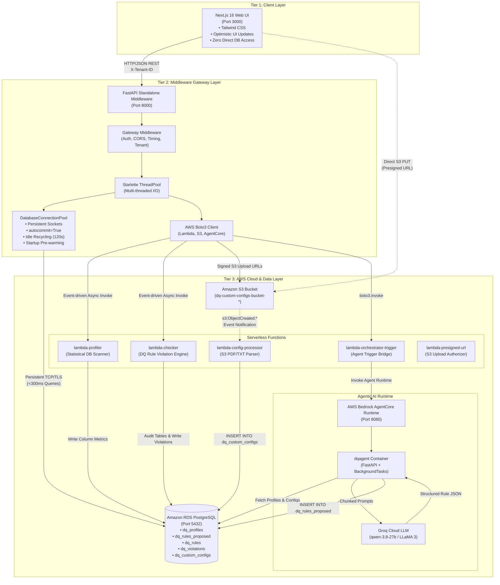
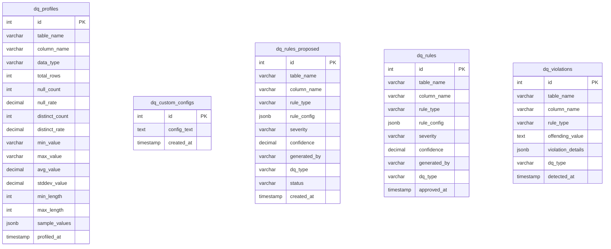
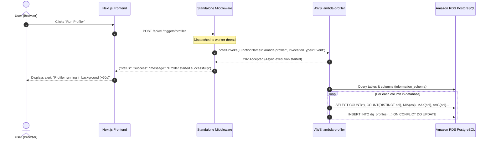
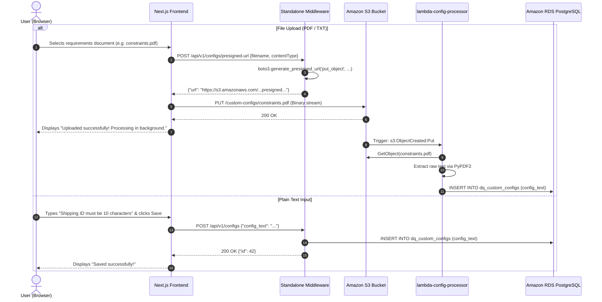
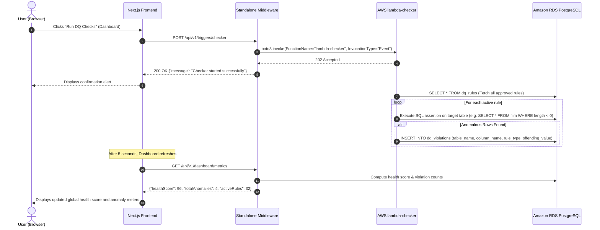

# Data Quality (DQ) Automation Platform — System Architecture & Component Guide

## Table of Contents
1. [Architectural Overview](#1-architectural-overview)
2. [Tier 1: Frontend Application (`frontend/`)](#2-tier-1-frontend-application-frontend)
   - [Architectural Role & Decoupling](#architectural-role--decoupling)
   - [Page Structure & Navigation](#page-structure--navigation)
   - [Optimistic UI & State Synchronization](#optimistic-ui--state-synchronization)
   - [Middleware Client Bridge](#middleware-client-bridge)
3. [Tier 2: Standalone Middleware Service (`middleware/`)](#3-tier-2-standalone-middleware-service-middleware)
   - [Purpose & Ingress Gateway Pipeline](#purpose--ingress-gateway-pipeline)
   - [High-Performance Connection Pooling (`connection.py`)](#high-performance-connection-pooling-connectionpy)
   - [Multi-Threading & Event Loop Architecture](#multi-threading--event-loop-architecture)
   - [Multi-Tenancy & Security Ingress](#multi-tenancy--security-ingress)
   - [API Endpoints Reference](#api-endpoints-reference)
4. [Tier 3: Cloud Infrastructure & Backend Services](#4-tier-3-cloud-infrastructure--backend-services)
   - [PostgreSQL RDS Database & Schema](#postgresql-rds-database--schema)
   - [AWS Lambda Function Suite](#aws-lambda-function-suite)
   - [Amazon S3 Custom Configurations Pipeline](#amazon-s3-custom-configurations-pipeline)
   - [AWS Bedrock AgentCore & Groq LLM Agent](#aws-bedrock-agentcore--groq-llm-agent)
5. [End-to-End Execution Workflows (Sequence Diagrams)](#5-end-to-end-execution-workflows-sequence-diagrams)
   - [Workflow A: Database Profiling](#workflow-a-database-profiling)
   - [Workflow B: Custom Business Constraint Ingestion (PDF / Text)](#workflow-b-custom-business-constraint-ingestion-pdf--text)
   - [Workflow C: AI-Augmented Rule Generation](#workflow-c-ai-augmented-rule-generation)
   - [Workflow D: Zero-Latency Rule Review & Approval](#workflow-d-zero-latency-rule-review--approval)
   - [Workflow E: Automated Data Quality Auditing (Checker)](#workflow-e-automated-data-quality-auditing-checker)
6. [Deployment & Containerization](#6-deployment--containerization)
7. [Environment Variables Reference](#7-environment-variables-reference)

---

## 1. Architectural Overview

The Data Quality Automation Platform uses a **decoupled 3-tier microservices architecture** designed for high throughput, low latency, and cloud portability.



---

## 2. Tier 1: Frontend Application (`frontend/`)

### Architectural Role & Decoupling
The frontend is a modern **Next.js (App Router) + React** web application that acts solely as a client-side presentation and interaction layer. 

Key architectural characteristics:
- **Zero Database Dependencies**: The frontend has no direct database access, no PostgreSQL client libraries (`pg`, `pg-pool`), and no AWS SDK credentials.
- **Removed API Routes**: All legacy Next.js internal API routes (`/src/app/api/*`) and database connectors (`/src/lib/db.js`) have been entirely removed.
- **Client-Side HTTP Gateway**: All communications with the system flow through a centralized, resilient client module: [`frontend/src/lib/middleware-client.js`](file:///c:/Users/Adithya/Desktop/dq-system/frontend/src/lib/middleware-client.js).

### Page Structure & Navigation

| Route | File Path | Purpose |
| :--- | :--- | :--- |
| `/` | [`frontend/src/app/page.js`](file:///c:/Users/Adithya/Desktop/dq-system/frontend/src/app/page.js) | **Data Health Dashboard**: High-level telemetry displaying the global Health Score percentage, total anomalies, active rules count, monitored tables count, table-level health breakdown, and manual trigger for the Lambda Checker. |
| `/rules` | [`frontend/src/app/rules/page.js`](file:///c:/Users/Adithya/Desktop/dq-system/frontend/src/app/rules/page.js) | **DQ Rules Review & Orchestration**: Main operations console. Displays proposed rules with dynamic filtering (Table, DQ Type, search query), pagination, single/batch approval/rejection, custom business configurations panel, rule editing modal, generation history tab, and trigger buttons for the Profiler and Agent. |
| `/configs` | [`frontend/src/app/configs/page.js`](file:///c:/Users/Adithya/Desktop/dq-system/frontend/src/app/configs/page.js) | **Custom Configurations Manager**: Dedicated interface for uploading business requirement documents (PDF/TXT) or entering manual text constraints. |
| `/database` | [`frontend/src/app/database/page.js`](file:///c:/Users/Adithya/Desktop/dq-system/frontend/src/app/database/page.js) | **Database Navigator & Profile Explorer**: Inspects table schemas, column data types, profiling metrics (null counts, distinct counts, min/max values), and allows inserting test records to validate rule enforcement. |

### Optimistic UI & State Synchronization
To provide an instantaneous desktop-like user experience across transcontinental WAN connections (e.g., India to AWS `us-east-1` in Virginia):
1. **0ms Perceived Latency**: When a user clicks **Approve**, **Reject**, **Approve All**, or **Reject All**, the React state immediately filters out the affected rule IDs (`setRules(prev => prev.filter(...))`). The item disappears from the screen in 0 milliseconds.
2. **Background Dispatch**: The network request (`middlewareApi.approveRule(id)`) fires asynchronously in the background.
3. **Graceful Error Recovery**: Only if the network request fails does the UI trigger a background re-sync (`fetchRules(true)`) and display an error alert to the user.
4. **Adaptive Polling**: Polling operates on a non-saturating 15-second interval and automatically suspends when the tab is hidden (`document.hidden`), preventing browser background thread starvation.

### Middleware Client Bridge
[`frontend/src/lib/middleware-client.js`](file:///c:/Users/Adithya/Desktop/dq-system/frontend/src/lib/middleware-client.js) encapsulates all HTTP calls using native `fetch`:
- Injects standard headers: `Content-Type: application/json` and `X-Tenant-ID: default`.
- Resolves the middleware base URL dynamically from `process.env.NEXT_PUBLIC_MIDDLEWARE_URL` (defaults to `http://localhost:8000`).
- Provides strongly typed methods: `getProposedRules()`, `approveRule(id)`, `approveAllRules(ids)`, `rejectRule(id)`, `rejectAllRules(ids)`, `getConfigs()`, `saveConfig(text)`, `deleteConfig(id)`, `getPresignedUrl(filename, type)`, `getMetrics()`, `getTables()`, `getDatabaseProfiles()`, `insertDatabaseRecord(table, payload)`, `triggerProfiler()`, `triggerChecker()`, `triggerAgent()`.

---

## 3. Tier 2: Standalone Middleware Service (`middleware/`)

### Purpose & Ingress Gateway Pipeline
The Standalone Middleware is a high-performance **FastAPI** service residing in `middleware/` that acts as the secure middle-tier API Gateway between the client applications and AWS infrastructure.

The ingress request pipeline consists of:
1. **`CORSMiddleware` (Outermost)**: Intercepts all cross-origin requests, immediately responding with `200 OK` to `OPTIONS` preflight requests from `http://localhost:3000` (or configured origins) with credentials and custom headers (`X-Tenant-ID`, `Content-Type`, `Authorization`).
2. **`StandaloneGatewayMiddleware` ([`middleware/app/core/middleware.py`](file:///c:/Users/Adithya/Desktop/dq-system/middleware/app/core/middleware.py))**:
   - Bypasses `OPTIONS` preflights directly to CORS.
   - Resolves tenant and user identity from incoming `X-Tenant-ID` headers or JWT tokens (via [`middleware/app/core/security.py`](file:///c:/Users/Adithya/Desktop/dq-system/middleware/app/core/security.py)).
   - Attaches `request.state.tenant_id` and `request.state.user_id` to request state.
   - Measures end-to-end request duration and stamps response headers: `X-Process-Time`, `X-Tenant-ID`, and `X-Gateway: DQ-Standalone-Middleware-v1`.
3. **Route Dispatcher**: Mounts endpoints under `/api/v1` grouped into modular routers: `dashboard`, `rules`, `configs`, `database`, `triggers`.

### High-Performance Connection Pooling (`connection.py`)
Direct connection handshakes (TCP 3-way handshake + TLS negotiation + PostgreSQL authentication) over WAN from a local machine to AWS RDS in Virginia take **2.5 to 4.0 seconds per request**.

[`middleware/app/db/connection.py`](file:///c:/Users/Adithya/Desktop/dq-system/middleware/app/db/connection.py) solves this with the `DatabaseConnectionPool`:
- **Persistent Connection Queue**: Keeps a pool of open, warm `pg8000` socket connections ready in a FIFO queue.
- **`autocommit = True`**: Eliminates explicit `BEGIN` and `COMMIT` round-trips over WAN, enabling PostgreSQL single-statement execution in a single transcontinental packet exchange (~0.3s vs ~2.5s).
- **0ms Acquire**: Connections are retrieved from the queue in 0 milliseconds without blocking synchronous `SELECT 1` ping round-trips.
- **Idle Connection Recycling**: Connections idle for more than 120 seconds are automatically closed and refreshed to prevent dropped sockets.
- **Startup Warmup**: The FastAPI `lifespan` handler ([`middleware/app/main.py`](file:///c:/Users/Adithya/Desktop/dq-system/middleware/app/main.py)) pre-warms database connections in a background thread on startup so the very first user request encounters 0ms cold-start latency.

### Multi-Threading & Event Loop Architecture
In FastAPI, declaring an endpoint as `async def` runs that endpoint directly on the main ASGI event loop. Because `pg8000` and `boto3` perform synchronous blocking socket I/O, an `async def` handler would completely lock the entire server for all clients until the database query completed.

**The Solution**: All database-interacting and AWS-triggering endpoints in the middleware routers are declared as standard synchronous functions (`def`), causing FastAPI to automatically dispatch them to Starlette's `ThreadPoolExecutor`. This allows multiple database queries and user actions to execute in true concurrency without blocking the ASGI event loop or stalling other users.

### Multi-Tenancy & Security Ingress
- [`middleware/app/core/security.py`](file:///c:/Users/Adithya/Desktop/dq-system/middleware/app/core/security.py) extracts tenant context from headers (`X-Tenant-ID`), subdomains, or optional JWT bearer tokens.
- When `REQUIRE_AUTH=false` (development mode), missing credentials gracefully default to `tenant_id="default"` and `user_id="anonymous"`.
- When `REQUIRE_AUTH=true` (production mode), requests without valid JWT signatures are rejected at ingress with HTTP 401 Unauthorized before reaching any database or AWS services.

### API Endpoints Reference

```
/api/v1/
├── dashboard/
│   ├── GET  /metrics                # Global Health score, active rules, anomaly counts
│   └── GET  /tables                 # Per-table anomaly breakdown and health status
├── rules/
│   ├── GET  /                       # Fetch all proposed rules (status = 'proposed')
│   ├── POST /approve                # Approve single rule: {"rule_id": 123}
│   ├── POST /approve-all            # Batch approve rules: {"rule_ids": [1, 2, ...]}
│   ├── POST /reject                 # Reject single rule: {"rule_id": 123}
│   ├── POST /reject-all             # Batch reject rules: {"rule_ids": [1, 2, ...]}
│   ├── POST /update                 # Update rule configuration JSON
│   ├── GET  /summary                # Summary counts of approved rules
│   └── GET  /history                # Generation history grouped by minute & source
├── configs/
│   ├── GET  /                       # List all active custom business rules
│   ├── POST /                       # Save raw custom constraint text
│   ├── DELETE /{config_id}          # Delete custom config by ID
│   ├── POST /delete                 # Delete custom config (POST compatibility)
│   └── POST /presigned-url          # Generate secure S3 presigned PUT URL
├── database/
│   ├── GET  /profiles               # Table schemas and column statistical profiles
│   └── POST /insert                 # Insert record into arbitrary monitored table
└── triggers/
    ├── POST /profiler               # Asynchronously triggers lambda-profiler via Boto3
    ├── POST /checker                # Asynchronously triggers lambda-checker via Boto3
    └── POST /agent                  # Triggers AWS Bedrock AgentCore orchestrator
```

---

## 4. Tier 3: Cloud Infrastructure & Backend Services

### PostgreSQL RDS Database & Schema
Hosted on Amazon RDS (PostgreSQL 15+) in your target AWS region:



- **`dq_profiles`**: Populated by `lambda-profiler`. Contains statistical distributions for every column across all monitored tables.
- **`dq_custom_configs`**: Stores domain-specific business rules and constraints extracted from uploaded PDFs, text files, or direct user input.
- **`dq_rules_proposed`**: Holds candidate rules generated by the AI Agents. Rules remain in `status = 'proposed'` until reviewed.
- **`dq_rules`**: Production-approved rules transferred atomically from `dq_rules_proposed` upon user approval.
- **`dq_violations`**: Audit findings logged by `lambda-checker` when production data breaches approved `dq_rules`.
- **Target Schema (Pagila)**: Sample relational DVD rental database schema (`actor`, `film`, `customer`, `payment`, `rental`, `inventory`) used for profiling, rule generation, and anomaly detection.

### AWS Lambda Function Suite

| Lambda Function | Runtime | Trigger Source | Purpose & Action |
| :--- | :--- | :--- | :--- |
| **`lambda-profiler`** | Python 3.12 | Invoked by Middleware via Boto3 (`/api/v1/triggers/profiler`) | Scans all user tables in PostgreSQL, computes column stats (nulls, distinct values, bounds, lengths, samples), and inserts/updates `dq_profiles`. |
| **`lambda-checker`** | Python 3.12 | Invoked by Middleware via Boto3 (`/api/v1/triggers/checker`) | Evaluates active records against approved `dq_rules`. Flags non-compliant rows and logs them into `dq_violations`. |
| **`lambda-config-processor`** | Python 3.12 | S3 Event: `s3:ObjectCreated:*` on `.pdf` or `.txt` in bucket | Triggered automatically when files arrive in the S3 custom configs bucket. Extracts plain text (using `PyPDF2` for PDFs) and inserts records into `dq_custom_configs`. |
| **`lambda-orchestrator-trigger`** | Python 3.12 | Invoked by Middleware (`/api/v1/triggers/agent`) | Bridges the invocation between the Middleware and AWS Bedrock AgentCore runtime using Boto3, avoiding Bedrock SigV4 signing complexities on the client. |
| **`lambda-presigned-url`** | Python 3.12 | API Gateway / Middleware | Alternative serverless endpoint generating S3 PUT presigned URLs with 15-minute expirations. |

### Amazon S3 Custom Configurations Pipeline
- **Bucket**: Dedicated S3 bucket for incoming business rules and documents (configured via `S3_BUCKET_NAME`).
- Direct client-to-S3 uploads are protected with short-lived presigned URLs generated by the Middleware ([`middleware/app/services/aws_service.py`](file:///c:/Users/Adithya/Desktop/dq-system/middleware/app/services/aws_service.py)).
- Direct PUT uploads trigger the S3 event notification configured in [`notification.json`](file:///c:/Users/Adithya/Desktop/dq-system/notification.json), which immediately wakes `lambda-config-processor`.

### AWS Bedrock AgentCore & Groq LLM Agent
- **Container**: `dqagent/` (ARM64 Docker image deployed on AWS Bedrock AgentCore runtime).
- **Hybrid Agent**: `dqagent_hybrid/` combines rule-based heuristic generation with LLM inference.
- **LLM Engine**: Groq Cloud API running `qwen/qwen3.8-27b` and `llama-3.3-70b-versatile`.
- **Anti-Timeout Architecture**:
  1. Bedrock receives `POST /invocations`.
  2. The agent server immediately returns HTTP 200 to satisfy Bedrock's 29-second gateway timeout.
  3. The generation loop runs in a FastAPI `BackgroundTask`.
  4. The background task fetches database profiles and custom configurations from RDS, batches columns into groups of 6, issues chat completions to Groq, parses JSON responses, and commits proposed rules to `dq_rules_proposed`.

---

## 5. End-to-End Execution Workflows (Sequence Diagrams)

### Workflow A: Database Profiling



### Workflow B: Custom Business Constraint Ingestion (PDF / Text)



### Workflow C: AI-Augmented Rule Generation

```mermaid
sequenceDiagram
    autonumber
    actor User as User (Browser)
    participant FE as Next.js Frontend
    participant MW as Standalone Middleware
    participant LOT as lambda-orchestrator-trigger
    participant AC as Bedrock AgentCore (dqagent)
    participant Groq as Groq LLM API
    participant DB as Amazon RDS PostgreSQL

    User->>FE: Clicks "Generate New Rules"
    FE->>MW: POST /api/v1/triggers/agent
    MW->>LOT: boto3.invoke("lambda-orchestrator-trigger")
    LOT->>AC: POST /invocations
    AC-->>LOT: 200 OK (Scheduled BackgroundTask)
    LOT-->>MW: 200 OK
    MW-->>FE: 200 OK {"message": "Generation started in AgentCore"}
    FE-->>User: Notification: "Generation started; rules will appear shortly."
    
    Note over AC: BackgroundTask Execution
    AC->>DB: SELECT * FROM dq_profiles
    AC->>DB: SELECT config_text FROM dq_custom_configs
    AC->>AC: Inject business constraints into System Prompt
    AC->>AC: Partition columns into batches of 6
    loop For each batch of columns
        AC->>Groq: chat.completions.create(model="qwen-3.8-27b", prompt=batch_prompt)
        Groq-->>AC: Structured JSON rules (null_check, regex, min_max, length...)
        AC->>DB: INSERT INTO dq_rules_proposed (table_name, column_name, rule_config, status='proposed')
    end
```

### Workflow D: Zero-Latency Rule Review & Approval

```mermaid
sequenceDiagram
    autonumber
    actor User as User (Browser)
    participant FE as Next.js Frontend
    participant MW as Standalone Middleware
    participant Pool as DatabaseConnectionPool
    participant DB as Amazon RDS PostgreSQL

    User->>FE: Clicks "Approve All (15)"
    Note over FE: 0ms Optimistic UI Update:<br/>Immediately removes items from UI table
    FE-->>User: Screen updates instantly (0ms lag)
    
    FE->>MW: POST /api/v1/rules/approve-all {"rule_ids": [101, 102, ...]}
    MW->>Pool: acquire() [0ms, warm persistent connection]
    Pool-->>MW: conn (autocommit=True)
    
    Note over MW,DB: Single Atomic Set SQL Roundtrip:
    MW->>DB: INSERT INTO dq_rules (...) SELECT ... FROM dq_rules_proposed WHERE id IN (101, 102, ...);
    MW->>DB: UPDATE dq_rules_proposed SET status = 'approved' WHERE id IN (101, 102, ...);
    DB-->>MW: Query OK (Executed in ~0.3s)
    
    MW->>Pool: release(conn)
    MW-->>FE: 200 OK {"message": "15 rules approved"}
    Note over FE: No full-table reload needed;<br/>State is already cleanly updated!
```

### Workflow E: Automated Data Quality Auditing (Checker)



---

## 6. Deployment & Containerization

The repository includes complete multi-container orchestration via [`docker-compose.yml`](file:///c:/Users/Adithya/Desktop/dq-system/docker-compose.yml).

### Local Execution (Docker Compose)
To start both the Frontend and Middleware in separate, isolated containers:

```bash
docker-compose up --build
```

- **Frontend**: Accessible at `http://localhost:3000`
- **Middleware**: Accessible at `http://localhost:8000` (Interactive Swagger docs at `http://localhost:8000/docs`)

### Manual Native Execution (Development)

**1. Start the Middleware (Terminal 1):**
```bash
cd middleware
pip install -r requirements.txt
python run.py
```

**2. Start the Frontend (Terminal 2):**
```bash
cd frontend
npm install
npm run dev
```

---

## 7. Environment Variables Reference

### Middleware (`middleware/.env`)
| Variable | Default Value | Description |
| :--- | :--- | :--- |
| `HOST` | `0.0.0.0` | Binding host address |
| `PORT` | `8000` | Port for the FastAPI server |
| `ENVIRONMENT` | `development` | Runtime environment (`development`, `production`) |
| `DB_HOST` | `your-rds-endpoint.amazonaws.com` | PostgreSQL RDS host endpoint |
| `DB_PORT` | `5432` | PostgreSQL port |
| `DB_NAME` | `postgres` | Target database name |
| `DB_USER` | `postgres` | RDS master username |
| `DB_PASSWORD` | `your-db-password` | RDS master password |
| `AWS_REGION` | `us-east-1` | AWS deployment region |
| `S3_BUCKET_NAME` | `your-s3-bucket-name` | S3 bucket storing uploaded business requirement files |
| `LAMBDA_PROFILER_NAME`| `lambda-profiler` | AWS Lambda function name for database profiler |
| `LAMBDA_CHECKER_NAME` | `lambda-checker` | AWS Lambda function name for data anomaly checker |
| `LAMBDA_AGENT_TRIGGER_NAME` | `lambda-orchestrator-trigger` | AWS Lambda function name bridging Bedrock AgentCore |
| `REQUIRE_AUTH` | `false` | When true, enforces JWT validation on all ingress requests |
| `DEFAULT_TENANT_ID` | `default` | Default tenant context when running single-tenant mode |

### Frontend (`frontend/.env.local`)
| Variable | Default Value | Description |
| :--- | :--- | :--- |
| `NEXT_PUBLIC_MIDDLEWARE_URL` | `http://localhost:8000` | URL of the Standalone FastAPI Middleware service |
